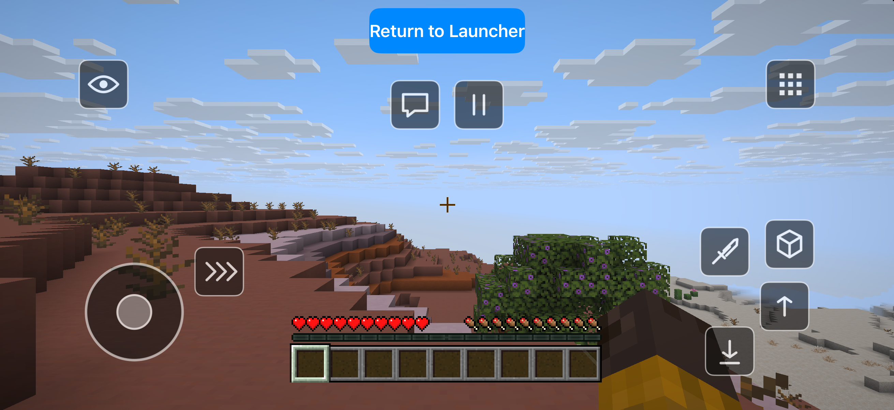

# Horizon iOS

An unofficial iPhone and iPad port of [Horizon](https://github.com/horizon-rust/horizon), the Rust rewrite of Minecraft: Java Edition 26.3.

**v0.2.0 build 11 (beta)** · [Download unsigned IPA](https://github.com/nixboi42/horizon-ios/releases/download/v0.2.0-beta.11/HorizonIOS-0.2.0-11-touch-toggles-unsigned.ipa) · [Installation](docs/install.md) · [Release notes](RELEASE_NOTES.md)

- Singleplayer
- Multiplayer (offline servers)
- Native launcher
- Multiple instances
- Customizable touch controls
- Audio and music
- iOS and iPadOS 15+ on arm64 devices

Re-sign the IPA to install it. Prepare resources from your own copy of Minecraft: Java Edition 26.3 and import them in the launcher.

Microsoft sign-in and online-mode servers are planned. See [known issues](docs/known-issues.md) for current limits.

[Build from source](docs/building.md) · [Architecture](docs/architecture.md) · [License](LICENSE) · [Upstream attribution](THIRD_PARTY_NOTICES.md)
